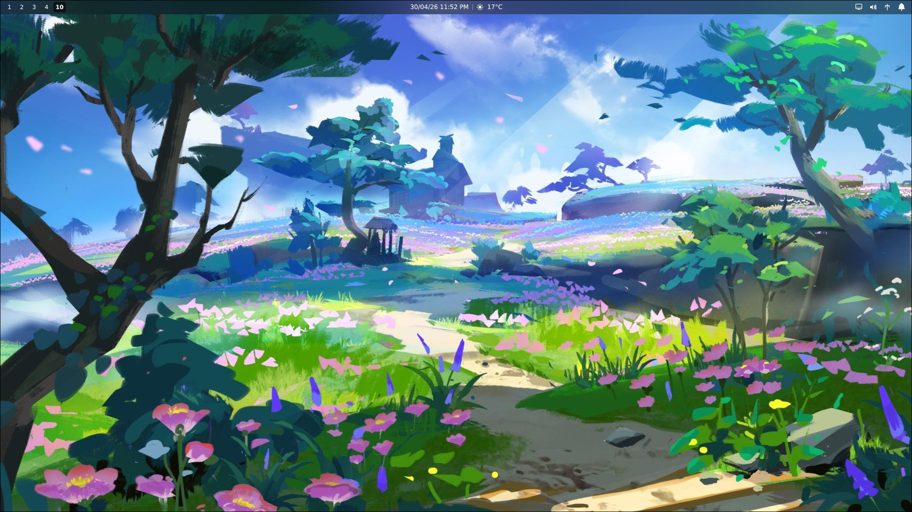
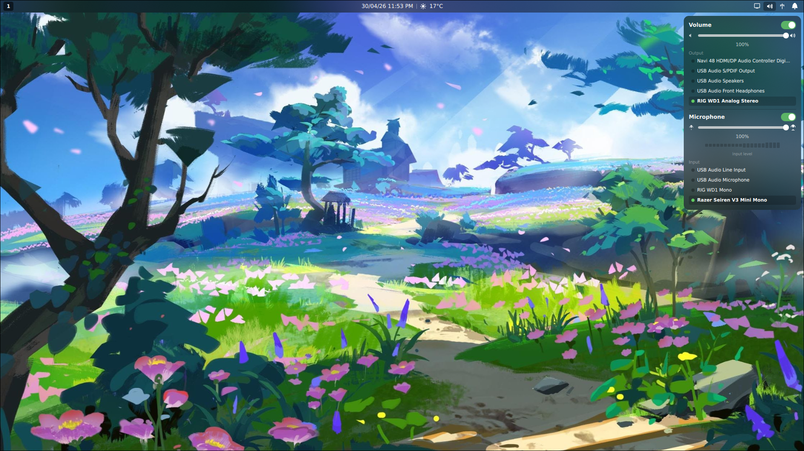
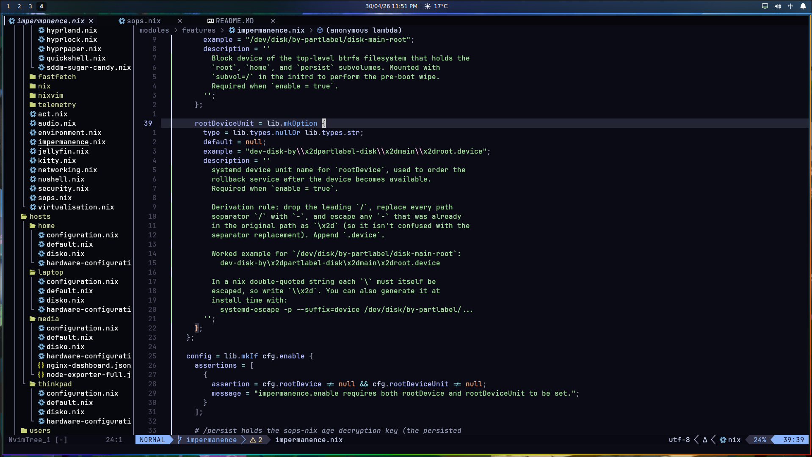

# Keanu Ashwell's NixOS Configuration

All my machines in one flake: desktops, laptops and home servers, running Hyprland, Neovim and home-manager.

<div align="center">
	
	
	
</div>
<br>

## Hosts

| Host | What it is |
|---|---|
| `home` | Desktop |
| `laptop`, `thinkpad` | Laptops |
| `media` | Media server: Jellyfin and the *arr stack |
| `homelab` | Home server |

## Layout

The flake uses [flake-parts](https://flake.parts) and [import-tree](https://github.com/vic/import-tree): every file
under `nix/` is a module and is picked up automatically.

| Path | What |
|---|---|
| `nix/hosts/` | One folder per machine: its configuration, hardware and disk layout |
| `nix/modules/` | Shared NixOS modules: desktop, networking, security, servers and more |
| `nix/users/` | Users and their home-manager configuration |
| `nix/packages/` | Packages and wrapped programs: Neovim, kitty, nushell and more |
| `secrets/` | Secrets, encrypted with [sops-nix](https://github.com/Mic92/sops-nix) |
| `terraform/` | Infrastructure that lives outside NixOS (see [its README](./terraform/README.MD)) |
| `tests/` | NixOS VM tests |

GitHub Actions builds the hosts and packages on every push.

## Usage

```bash
# Rebuild the machine you're on
sudo nixos-rebuild switch --flake .#<host>

# Deploy to another machine over Tailscale
nix run .#deploy-rs -- .#<host>

# Install a new machine from the NixOS installer (with the key USB mounted)
nix run .#deploy-host -- --host <host> --ip <address>
```

## Secrets

Secrets are encrypted with sops and age. Each machine decrypts them with its own SSH host key.

```bash
# Edit secrets
nix-shell -p sops age --run 'sops secrets/secrets.yaml'

# Get a machine's age key, to add it to .sops.yaml
nix-shell -p ssh-to-age --run 'cat /etc/ssh/ssh_host_ed25519_key.pub | ssh-to-age'

# Re-encrypt after changing .sops.yaml
nix-shell -p sops age --run 'sops updatekeys secrets/secrets.yaml'
```

A new machine needs its sops keys in place before its first boot, so install it with `deploy-host`: it copies the
keys from the USB and runs [nixos-anywhere](https://github.com/nix-community/nixos-anywhere). The details are in
`nix/deploy.nix`.
